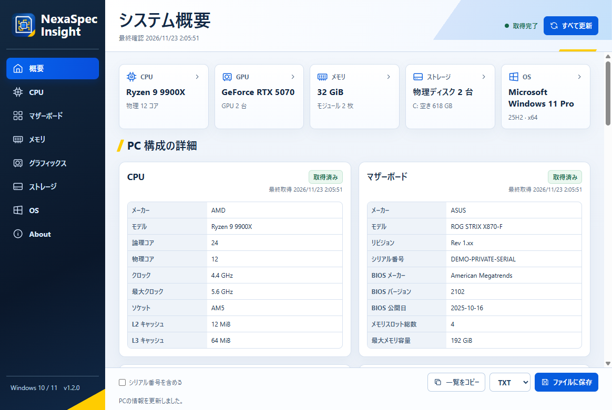

# NexaSpec Insight

Windows 10 / 11（x64）向けの PC スペック・システム情報ツールです。旧称は PC Spec Tool です。

[最新版をダウンロード](https://github.com/aki-sho/nexaspec-insight/releases/latest) · [更新履歴](CHANGELOG.md)



## 主な機能

- **概要** — CPU、GPU、メモリ、ストレージ、OS の主要情報を確認し、カードから各項目の詳細を開けます。
- **ハードウェア詳細** — CPU のソケットとキャッシュ、マザーボードと BIOS、メモリモジュール、GPU とディスプレイ、物理ディスクとボリュームを表示します。
- **システム情報** — Windows のバージョン・ビルド、インストール日、最終起動日時、稼働時間、起動モードを確認できます。
- **再取得** — すべての項目を更新するほか、取得に失敗した項目だけを再試行できます。更新できなかった項目は、前回の値があれば区別して表示します。
- **コピー・保存** — 一覧をコピーしたり、TXT・JSON に保存したりできます。シリアル番号は既定で出力から除外し、必要な場合は「シリアル番号を含める」を選べます。

アプリはローカルで動作します。機器やドライバーから取得できない項目は「—」で表示します。空き容量はボリューム単位です。

## ダウンロードと起動

| 配布形式 | ファイル | 使い方 |
| --- | --- | --- |
| インストール版 | `NexaSpec-Insight-Setup-1.2.0.exe` | EXE を実行してセットアップします。 |
| ポータブル版 | `NexaSpec-Insight-Portable-1.2.0.exe` | 書き込み可能なフォルダーから EXE を起動します。 |
| ポータブル ZIP | `NexaSpec-Insight-Portable-1.2.0.zip` | ZIP を展開し、同梱の EXE を起動します。 |

各ファイルに SHA-256 チェックサムが付属します。ポータブル版の設定とキャッシュは EXE と同じ場所の `NexaSpec-Insight-PortableData` に保存します。旧版と同じ場所に置いた場合は、既存の `PC-Spec-Tool-PortableData` を引き続き使用できます。

配布 EXE はコード署名なしです。Windows の SmartScreen が起動時に警告を表示する場合があります。

## 開発と配布物の検証

Windows 上で Node.js 24 系と npm を使います。

```powershell
git clone https://github.com/aki-sho/nexaspec-insight.git
cd nexaspec-insight
npm ci
npm start
```

```powershell
npm test
npm run test:security
npm audit --omit=dev
npm run build:release
```

統合テストでは Electron を一時フォルダーで起動し、Windows の情報取得、複数機器の表示、再試行、コピーと保存、最小ウィンドウサイズ、CSP と IPC の送信元制限を検証します。ビルドはパッケージの内容とポータブル ZIP の構成も検証し、成果物を `dist/1.2.0/` に出力します。
